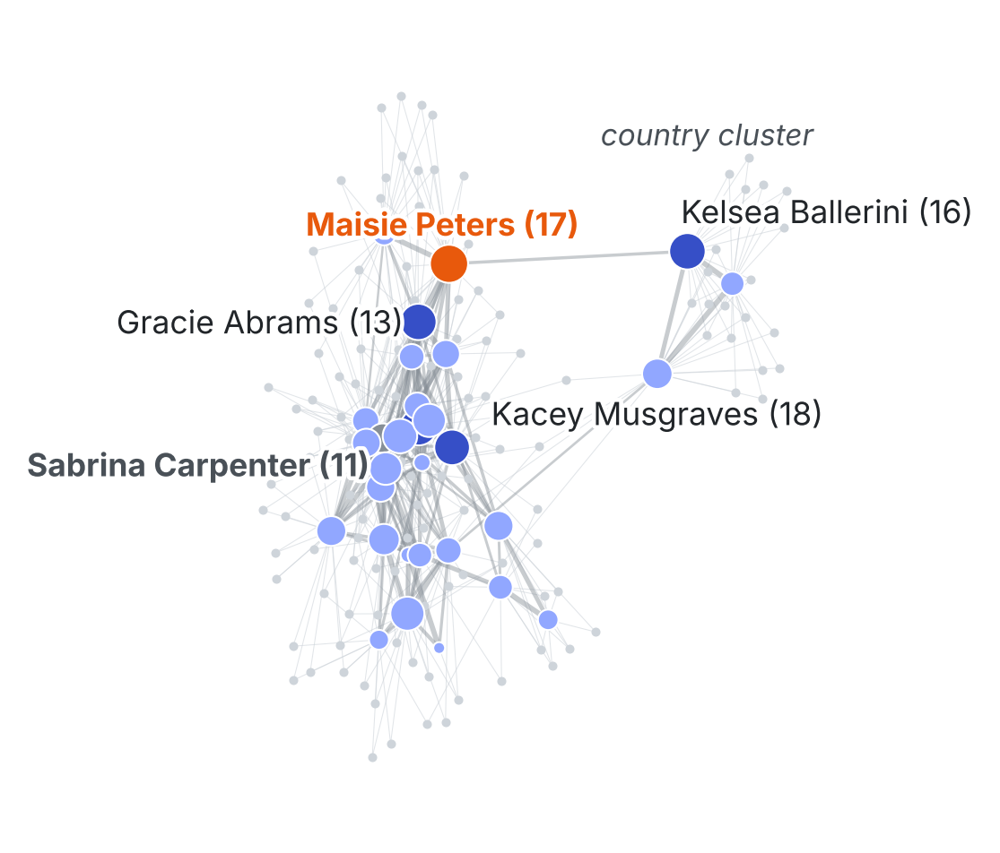

# Which artist takes a brand from Swifties to new audiences?

**MADT 7202 · Mid-term individual assignment (network analysis)**
Phanitphan Eaimnon · 6810424008 · NIDA

A brand that wants to reach Taylor Swift's fans should not simply pick the artist *most similar* to Swift, because that artist's fans are already Swift's fans. This project builds an artist-similarity network from the Last.fm API, **removes Taylor Swift (the seed) before ranking**, and looks for the artist who is close to Swift's audience **and** bridges to other listener groups.

*14 of the 30 artists Last.fm lists as similar to Swift (seed removed, cutoff 0.30). Each keeps its 3 strongest links plus every link into the country cluster (teal). Node size = bridge robustness across 12 configurations; orange = Maisie Peters (most robust bridge); grey = Sabrina Carpenter (most similar to Swift). The orange edge (0.53) is the only country link that survives cutoff 0.4. Data: Last.fm.*

---

## The decision

| | |
|---|---|
| **Decision maker** | Brand Manager of a Thai lifestyle brand (hypothetical client) |
| **Decision** | Pick **one** partner artist for a Q1 2027 Swiftie-targeted campaign, by 15 Nov 2026 |
| **If the result were different** | If no artist is both close to Swift's fans and a bridge to other audiences, pick the most similar artist and run a retention-only campaign |

## Why a network

A spreadsheet can rank artists by similarity to Swift, but that only finds the *same* fans. To grow reach, the brand needs an artist who sits on the paths between Swift's circle and other listener groups. That is **betweenness centrality**, a property of the whole web of artist-to-artist overlaps, not of any single row.

## Key findings

| Artist | Similarity to Swift (rank of 30) | Mean bridge rank (12 configs) | Top-5 bridge in |
|---|---|---|---|
| **Maisie Peters** | 0.47 (4) | **2.7** | **12 / 12** |
| Halsey | 0.29 (19) | 4.7 | 8 / 12 |
| Gracie Abrams | 0.91 (2) | 5.4 | 5 / 12 |
| Sabrina Carpenter | 1.00 (1) | 14.5 | 0 / 12 |

1. **The most similar artist is not the pick.** Sabrina Carpenter has similarity 1.00 (rank 1 of 30) but is a top-5 bridge in 0 of 12 configurations (best rank 6).
2. **Maisie Peters is the robust bridge.** Top-5 in 12/12 configurations, top-3 in 8/12, with 17 neighbours outside Swift's circle. Her edge to Kelsea Ballerini (0.53) is one of only 2 links between the country cluster (Ballerini, Musgraves, Morris) and the other 27 candidates, and the only one at cutoff 0.4.
3. **The default result is fragile.** Gracie Abrams is #1 at every cutoff under weighted betweenness with max-symmetrisation, but top-5 in only 5/12 configurations (worst rank 9). Similarity and bridging correlate only moderately (Spearman ρ = 0.52, p = 0.003).

**Recommendation:** Maisie Peters as primary partner; Gracie Abrams as backup.

---

## Data

| | |
|---|---|
| **Source** | Last.fm API: `artist.getSimilar` (2 hops from Taylor Swift: 30 + 30×30) and `artist.getTopTags` |
| **Size** | 929 similarity records, 337 unique artists |
| **Pulled** | 16 Oct 2026, 10:46 UTC (single pull) |
| **Permission** | [Last.fm API Terms of Service](https://www.last.fm/api/tos): non-commercial use, credited to Last.fm; academic use notified to partners@last.fm. About 190 API calls at ≤4 requests/second, with local caching |
| **Personal data** | None. Only artist-level aggregates are collected; no user profiles or listening histories (PDPA) |

**Sampling limitations**
- Last.fm users skew Western and towards heavy, engaged listeners. Thai fans and T-pop artists are under-represented.
- All 30 candidates had their 30 neighbours fetched, so candidates are compared on equal terms. Second-hop artists are **not** ranked, because their own neighbours were not fetched.
- Tags come from the same provider, so they serve as a construction check, not an independent source.

## Graph construction

| Step | Choice |
|---|---|
| Node | Artist |
| Edge | Last.fm lists the two artists as similar (shared listeners) |
| Weight | Last.fm `match` score (0–1); if A→B ≠ B→A, take the max |
| Seed | **Taylor Swift removed before any ranking** |
| Pruning | Drop edges below 0.30; iteratively drop nodes with degree < 2; keep the largest component |
| Result | 158 nodes, 520 edges |
| Metric | Betweenness centrality, with edge distance = 1 − similarity |
| Generic tags excluded | e.g. "seen live", "female vocalists", "pop", "my top songs", nationality tags |

## Robustness checks

1. **12-configuration grid:** cutoff {0.2, 0.3, 0.4} × symmetrise {max, mean} × betweenness {weighted, unweighted}. Maisie Peters is the only candidate in the top 5 in all 12.
2. **Alternative construction (shared-tag Jaccard):** edges based on overlapping genre tags instead of shared listeners rank Halsey #1 and Maisie Peters 19th. Tags describe genre labels rather than shared audiences, so the decision uses the listening-based graph.
3. **Cutoff sweep on the default construction:** Gracie Abrams stays #1 at 0.2, 0.3 and 0.4. This looks stable but depends on the weighting choice, as the grid shows.

## What would change the recommendation

- Last.fm overlap is global and Western-skewed. If a Thai check (a survey of Thai Swifties or Thai streaming charts) shows low local awareness of Maisie Peters, switch to Gracie Abrams (0.91 overlap with Swift).
- Betweenness shows network position, not proven fan transfer. Artist fees and availability are not modelled.

---

## Repository contents

| File | What it is |
|---|---|
| `swiftie_bridge_artists.ipynb` | Full pipeline, executed with outputs |
| `raw_similar_edges.csv` | 929 raw similarity records from `artist.getSimilar` |
| `artist_tags.csv` | Top tags per artist (generic tags removed) |
| `shortlist.csv` | 30 candidates with similarity, betweenness and outside reach (default construction) |
| `robustness_cutoff.csv` | Cutoff sweep 0.2 / 0.3 / 0.4 |
| `robustness_12configs.csv` | Bridge rank of every candidate across the 12 configurations, plus tag-graph rank |
| `robustness_12configs_top3.csv` | Top-3 bridges per configuration |
| `summary_for_A4.csv` | All numbers used on the one-page report |
| `fig_a4_network.png` | Figure on the one-page report (14 key artists) |
| `fig_full_graph_key_nodes.png` | Full-graph view: the 30 candidates plus all outside artists |
| `fig_network.png`, `fig_scatter.png` | Exploratory figures (full graph; similarity vs betweenness) |

## How to reproduce

**Option A: re-run from the saved data (no API key needed)**

1. Open `swiftie_bridge_artists.ipynb` in Google Colab or Jupyter.
2. Upload `raw_similar_edges.csv` and `artist_tags.csv` to the same folder.
3. Run all cells. The notebook detects the saved CSVs and makes no API calls.

**Option B: pull fresh data**

1. Create a free Last.fm API key at https://www.last.fm/api/account/create
2. In the first code cell, replace `PASTE_YOUR_LASTFM_API_KEY_HERE` with your key. **Do not commit your key.**
3. Delete `raw_similar_edges.csv` and `artist_tags.csv`, then run all cells (about 5–10 minutes).
4. Results will differ slightly from the report, because Last.fm similarity is updated continuously.

Requirements: Python 3.10+, `pandas`, `numpy`, `networkx`, `matplotlib`, `scipy`, `requests`.

---

*Data courtesy of [Last.fm](https://www.last.fm), used for non-commercial academic purposes under the Last.fm API Terms of Service. Artist names belong to their respective owners; this project is not affiliated with or endorsed by any artist or by Last.fm.*
